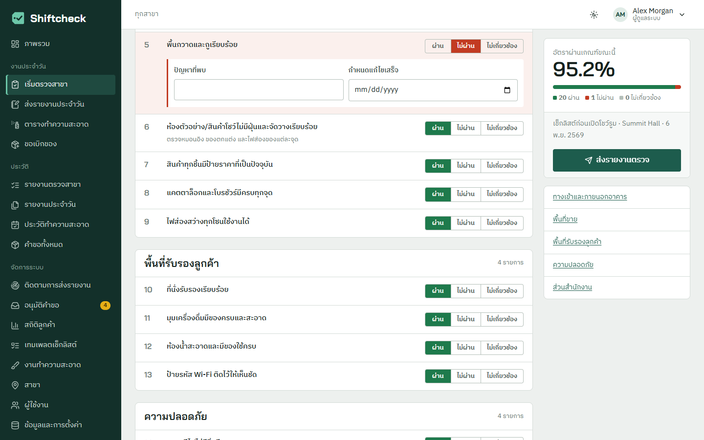
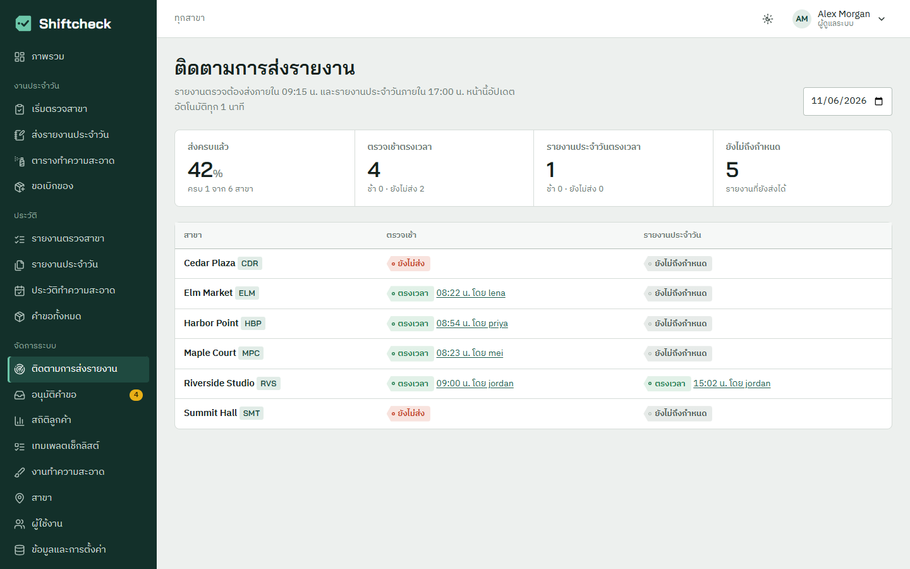
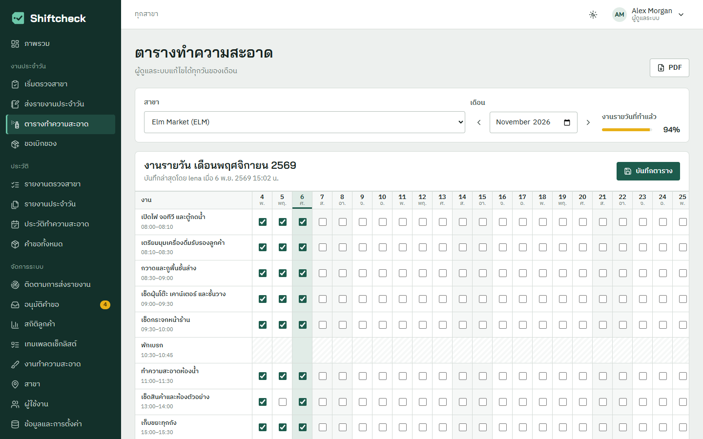
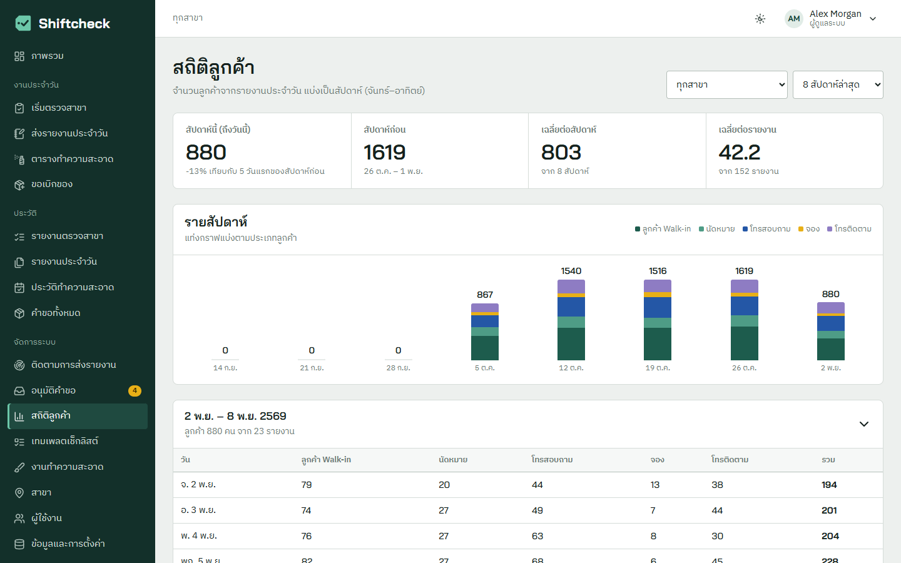
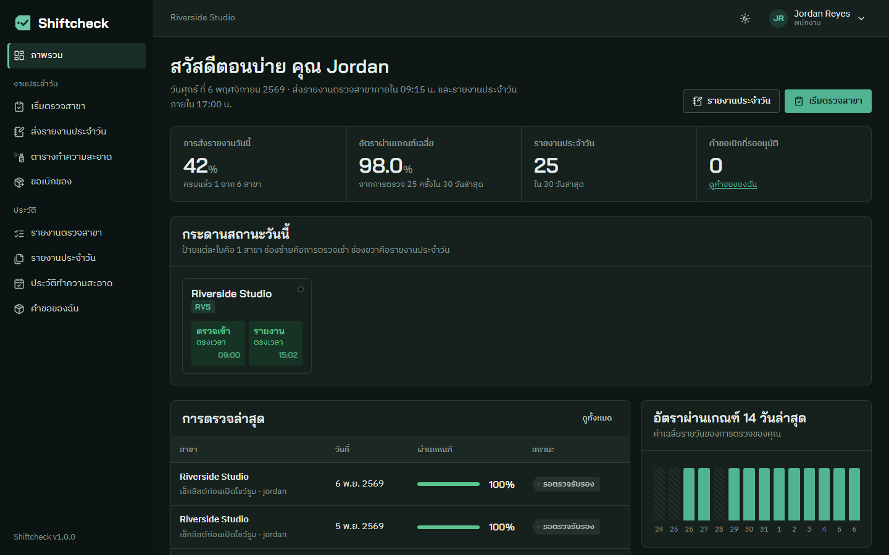
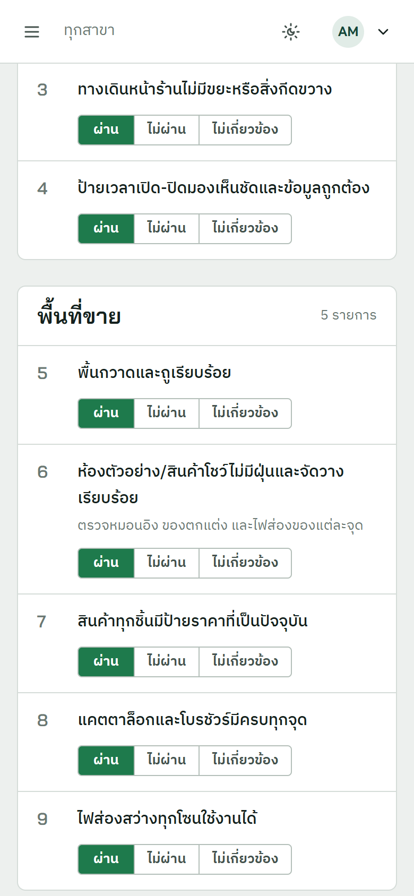

# Shiftcheck

Daily operations checklists and shift reporting for teams that run several physical locations — showrooms, retail stores, clinics, offices.

Each morning a team member walks their site with a checklist on their phone, marks every item pass/fail with photo evidence and signs it off. At the end of the day they file a shift report with staffing, visitor counts and notes. Managers get a live board showing which locations are on time, late or missing, can review and verify submissions, and export everything as PDF.

The interface is in **Thai**, with Thai dates in the Buddhist Era calendar (e.g. 6 พ.ย. 2569). The code, comments and this README are in English.


## Features

**For the team on site**
- **Site audits** built from admin-defined checklist templates. Each item is Pass / Fail / N/A; a failed item asks for the evidence fields its template defines (text, number or date).
- **Photo capture** from the live camera (front/back switch) or by upload, compressed in the browser and stored as WebP. Optionally restrict to live-camera only.
- **On-screen signatures** for sign-off, saved as PNG.
- **Shift reports** with staffing, visitor counts, morning briefing and end-of-day notes. Reports reuse the same day's audit data when fields are left blank.
- **Monthly cleaning schedule** — a day-by-task grid plus a rotating weekly deep-clean task. Team members can only edit today; earlier days are locked server-side.
- **Item requests** for supplies or equipment, with an approval queue.

**For managers**
- **Live submission monitor** with configurable deadlines (on time, late, missing, not due yet), refreshing every minute.
- **Manager review** of headcount and dress code on each submission.
- **Checklist template editor** — sections, items, guidance text, evidence fields and photo limits. Audits store a snapshot, so editing a template never rewrites history.
- **Visitor analytics** by week and visitor type.
- **Management summary** for each audit, written by AI when a Gemini key is configured, otherwise generated from the results.
- **Optional AI photo check** (Google Gemini): people count vs. reported headcount, full-body framing, dress code against your written policy, and detection of photos taken of a screen.
- **PDF export** for audits, shift reports and cleaning schedules.
- **People and locations** management, temporary passwords with forced change, password expiry, data retention cleanup.

**Across the app:** responsive from phone to desktop, light and dark themes, keyboard-accessible controls, CSRF protection on every form and API call.

## Screenshots

The screenshots use fictional sample data: none of the names, locations or numbers are real.

| | |
|---|---|
|  Site audit — failed items open evidence fields; the score updates live |  Audit detail with issues, sign-offs and manager review |
|  Checklist template editor |  Submission monitor |
|  Monthly cleaning schedule |  Visitor analytics |
|  Dark theme, team-member view |   |

## Tech stack

| Layer | Choice |
|---|---|
| Backend | Python 3.12, Flask 3 (app factory + blueprints) |
| Database | MySQL 8 via PyMySQL, plain SQL with JSON columns |
| Front end | Server-rendered Jinja templates, vanilla JavaScript, hand-written CSS design system |
| Documents | ReportLab (PDF, Thai font TH Sarabun New), Pillow (image processing) |
| Fonts | Bai Jamjuree and IBM Plex Sans Thai (Google Fonts) for the web UI |
| AI (optional) | Google Gemini REST API |
| Tooling | Docker Compose for MySQL, pytest |

No front-end build step: the CSS and JS are served as-is.

## Architecture

```
Browser ──► Flask app (shiftcheck/)
              ├── routes/      HTTP layer: one blueprint per area
              │     auth · dashboard · audits · reports · cleaning · requests · admin · uploads
              ├── services/    business logic, no request handling
              │     checklists  template CRUD, scoring, snapshots
              │     submissions deadline status per location
              │     cleaning    month layout, weekly rotation, scoped merges
              │     analytics   weekly visitor aggregation
              │     media       photo/signature storage and validation
              │     pdf         ReportLab exports
              │     ai          Gemini calls with graceful fallback
              │     retention   old-data cleanup incl. files
              ├── security.py  CSRF, login/admin decorators, password policy
              ├── db.py        connection helpers, transactions, schema bootstrap
              └── templates/ + static/
                         │
                         ▼
                    MySQL 8 (schema.sql)
```

**Data model:**
- `checklist_templates → checklist_sections → checklist_items`: editable templates.
- `site_audits`: each audit stores a JSON snapshot of the checklist with results, staffing, briefing, sign-offs and photo paths.
- `shift_reports`, `cleaning_schedules`, `cleaning_tasks` and `item_requests` hold the other daily records.
- `branches` (locations) and `users`.

**Design decisions:**
- **Snapshots over joins for history.** An audit copies the checklist it was filled against, so templates can change freely without altering past records.
- **Server-enforced permissions.** Team members only see their own location's records; requests for other records return 404. Cleaning-sheet edits outside the allowed day or week are dropped on the server, not just disabled in the UI.
- **Uploads are validated, not trusted.** Images are decoded with Pillow and re-encoded. A pre-uploaded file can only be attached by the person who uploaded it.
- **AI is optional.** With no API key the app is fully usable: summaries fall back to a rule-based report and the photo check is hidden.
- **One clock.** Database sessions use the app server's UTC offset, so `NOW()` and the deadline checks agree.

## Getting started

### Prerequisites
- Python 3.11+
- Docker (for MySQL), or an existing MySQL 8 server

### 1. Configure
```bash
git clone https://github.com/Darkfullmoon/LXP_Sale-Moniter.git
cd LXP_Sale-Moniter
cp .env.example .env
```
Edit `.env`:
- Set `DB_PASSWORD` and `DB_ROOT_PASSWORD`.
- Set `SECRET_KEY` (generate one with `python -c "import secrets; print(secrets.token_hex(32))"`).
- Optionally set `ADMIN_PASSWORD`.

### 2. Start the database
```bash
docker compose up -d
```
MySQL listens on `127.0.0.1:3320` by default.

### 3. Install and run
```bash
python -m venv .venv
source .venv/bin/activate          # Windows: .venv\Scripts\activate
pip install -r requirements.txt
python app.py                       # creates tables and the first admin, then serves on :8000
```

Open http://127.0.0.1:8000.

### 4. First sign-in

The first start creates one administrator account (`ADMIN_USERNAME`, default `admin`):
- If `ADMIN_PASSWORD` is set in `.env`, that is the password.
- If it is empty, a temporary password is printed once in the console, and you must change it at first sign-in.

The database starts empty. As the admin:
1. Add your **locations**.
2. Create a **checklist template** in the template editor, with sections, items and evidence fields.
3. Add the **cleaning tasks** for the monthly schedule.
4. Create **team member accounts** and assign each one to a location. Each new account gets a temporary password.

The team can then start filing audits and shift reports.

## Configuration

All settings are environment variables; see [`.env.example`](.env.example).

| Variable | Default | Purpose |
|---|---|---|
| `AUDIT_DEADLINE` / `REPORT_DEADLINE` | `09:15` / `17:00` | On-time cut-offs for the monitor |
| `RETENTION_MONTHS` | `4` | Age at which records can be cleaned up (`0` = off) |
| `PASSWORD_MAX_AGE_DAYS` | `90` | Forces team members to change passwords (`0` = off) |
| `REQUIRE_LIVE_CAMERA` | `false` | `true` hides the upload option so photos must be taken live |
| `GEMINI_API_KEY` | empty | Enables AI summaries and the photo check; comma-separate several keys |
| `DRESS_CODE_POLICY` | generic text | Policy the AI photo check compares against |
| `UNIFORM_REFERENCE_DIR` | empty | Optional folder of reference uniform photos for the AI check |
| `URL_PREFIX` | empty | Serve under a sub-path, e.g. `/shiftcheck` behind a reverse proxy |
| `DB_TIMEZONE` | local offset | Timezone for database timestamps, e.g. `+07:00` |

Browsers only allow camera access on HTTPS or `localhost`. Behind a TLS-terminating proxy, `X-Forwarded-*` headers are honoured.

## Maintenance commands

```bash
flask --app app init-db      # create tables / first admin
flask --app app retention    # delete records older than RETENTION_MONTHS (cron-friendly)
```

## Tests

The suite runs against a separate database (`shiftcheck_test` by default, or set `TEST_DB_NAME`). Tables are dropped and recreated on each run.

```bash
pip install -r requirements-dev.txt
# The DB_USER from .env needs rights on the test database, e.g. as MySQL root:
#   CREATE DATABASE shiftcheck_test; GRANT ALL ON shiftcheck_test.* TO 'shiftcheck'@'%';
pytest
```

The tests cover:
- authentication and forced password changes, CSRF rejection and open-redirect protection
- role permissions, cross-location isolation, and the full audit lifecycle (submit → view → PDF → summary → verify → delete, including file cleanup)
- template snapshots, upload validation, shift reports and analytics, and item approvals
- admin safeguards, cleaning-schedule edit scope, deadline status, timezone handling and retention

## Project structure

```
shiftcheck/
├── app.py                  development entry point
├── schema.sql              database schema
├── docker-compose.yml      local MySQL
├── shiftcheck/
│   ├── __init__.py         app factory, hooks, error pages
│   ├── config.py           environment settings
│   ├── routes/             blueprints
│   ├── services/           business logic
│   ├── templates/          Jinja pages and macros
│   └── static/             css/app.css, js/app.js, js/template-editor.js
├── tests/                  pytest suite
└── docs/screenshots/
```

## Future improvements

- Corrective-action tracking: turn failed items into assigned tasks with due dates and closure.
- Scheduled email or chat digests of missing submissions.
- Offline-first audit form (service worker and background sync) for sites with weak signal.
- Per-location deadlines and opening hours.
- Object storage (S3-compatible) for photos instead of local disk.
- English/Thai language switch with Flask-Babel.
- Database migrations with Alembic once the schema starts evolving.

## License

Released under the [MIT License](LICENSE).

The bundled PDF font in `shiftcheck/fonts/` is TH Sarabun New. It was released by Thailand's Software Industry Promotion Agency (SIPA) as a free font that may be used and redistributed, and it is not covered by the MIT license.
