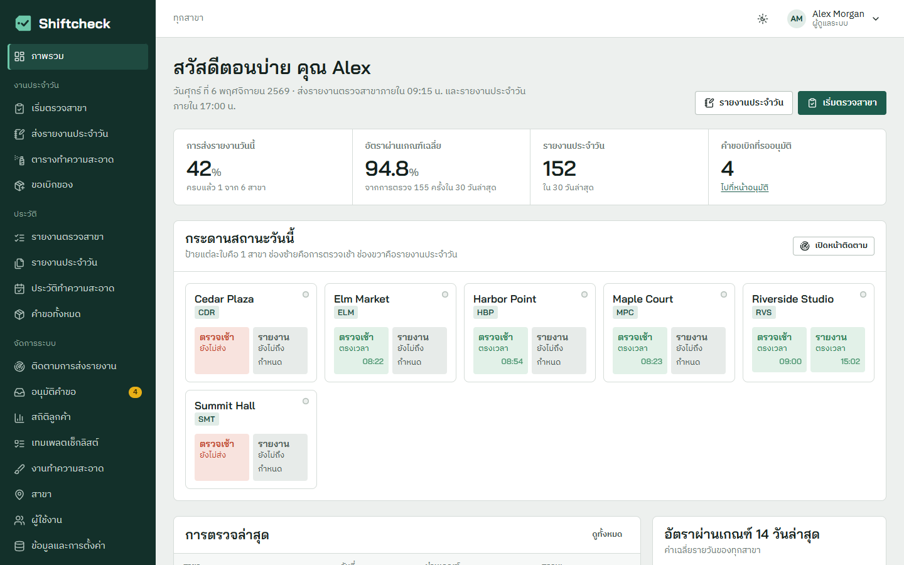
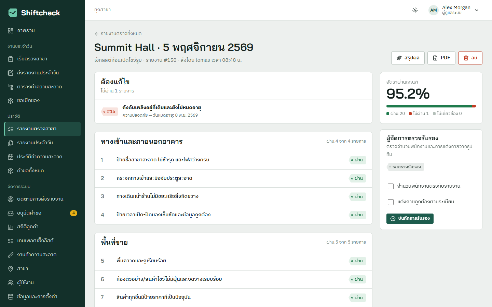
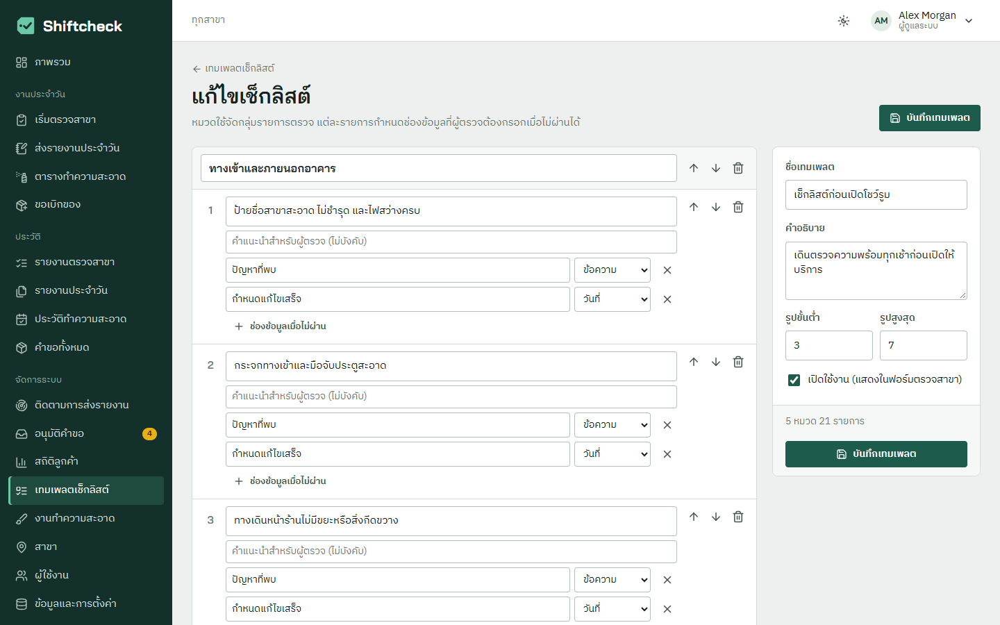
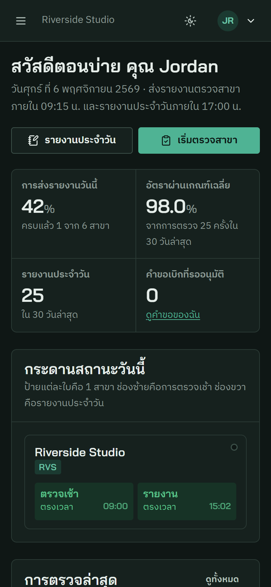

# Shiftcheck

ระบบเช็กลิสต์ประจำวันและรายงานกะ สำหรับทีมที่ดูแลหลายสาขา (โชว์รูม ร้านค้า สำนักงาน)

- **พนักงาน** เดินตรวจสาขาตอนเช้าด้วยมือถือ ติ๊กผ่าน/ไม่ผ่าน ถ่ายรูป เซ็นชื่อ และส่งรายงานตอนเย็น
- **ผู้จัดการ** ดูได้ทันทีว่าสาขาไหนส่งตรงเวลา ส่งช้า หรือยังไม่ส่ง ตรวจรับงาน และดาวน์โหลดเป็น PDF



## ทำอะไรได้บ้าง

- ตรวจสาขาตามเช็กลิสต์ (ผ่าน / ไม่ผ่าน / ไม่เกี่ยวข้อง) พร้อมแนบรูปและลายเซ็น
- รายงานกะ: จำนวนพนักงาน จำนวนลูกค้า บันทึกประจำวัน
- ตารางทำความสะอาดรายเดือน
- ขอเบิกของ พร้อมขั้นตอนอนุมัติ
- หน้าติดตามการส่งงานของแต่ละสาขา
- แก้ไขแม่แบบเช็กลิสต์ได้เอง
- สถิติลูกค้ารายสัปดาห์
- ส่งออก PDF
- (ไม่บังคับ) ใช้ AI ของ Google Gemini สรุปผลและตรวจรูป

## ภาพหน้าจอ

| ตรวจสาขา | รายละเอียดการตรวจ |
|---|---|
|  |  |
| **ติดตามการส่งงาน** | **แก้ไขแม่แบบเช็กลิสต์** |
|  |  |
| **ตารางทำความสะอาด** | **สถิติลูกค้า** |
|  |  |
| **โหมดมืด** | **บนมือถือ** |
|  |   |

## วิธีติดตั้งและใช้งาน

ต้องมี **Python 3.11 ขึ้นไป** และ **Docker**

**1. ดาวน์โหลดโค้ดและตั้งค่า**
```bash
git clone https://github.com/Darkfullmoon/shiftcheck.git
cd shiftcheck
cp .env.example .env
```
เปิดไฟล์ `.env` แล้วใส่ `DB_PASSWORD`, `DB_ROOT_PASSWORD` และ `SECRET_KEY`
(สร้าง SECRET_KEY ได้ด้วยคำสั่ง `python -c "import secrets; print(secrets.token_hex(32))"`)

**2. เปิดฐานข้อมูล**
```bash
docker compose up -d
```

**3. ติดตั้งและรันโปรแกรม**
```bash
python -m venv .venv
.venv\Scripts\activate        # Mac/Linux ใช้: source .venv/bin/activate
pip install -r requirements.txt
python app.py
```

**4. เปิดเว็บ** ที่ http://127.0.0.1:8000

## เข้าสู่ระบบครั้งแรก

- ชื่อผู้ใช้: `admin`
- รหัสผ่าน: ตามที่ตั้งไว้ใน `ADMIN_PASSWORD` ในไฟล์ `.env`
  ถ้าไม่ได้ตั้ง ระบบจะแสดงรหัสชั่วคราวในหน้าจอ console ตอนรัน และให้เปลี่ยนรหัสเมื่อเข้าครั้งแรก

จากนั้นให้ admin ตั้งค่าตามลำดับ:
1. เพิ่มสาขา
2. สร้างแม่แบบเช็กลิสต์
3. เพิ่มงานทำความสะอาด
4. สร้างบัญชีพนักงานและกำหนดสาขา

## AI ตรวจรูป (ไม่บังคับ)

ระบบใช้ Google Gemini ช่วยตรวจ **รูปทีมรูปแรก** ที่แนบมากับการตรวจสาขาหรือรายงานกะ โดยดูว่า:

- **จำนวนคน** ในรูปตรงกับจำนวนพนักงานที่กรอกไว้หรือไม่
- **ถ่ายเห็นเต็มตัว** หรือไม่
- **การแต่งกาย** ตรงตามระเบียบที่ตั้งไว้ใน `DRESS_CODE_POLICY` หรือไม่
- เป็น **รูปที่ถ่ายจากหน้าจอ** (ไม่ใช่ถ่ายจริง) หรือไม่

กดปุ่มตรวจรูปได้ในหน้ารายละเอียดของการตรวจสาขาหรือรายงานกะ ระบบเก็บผลไว้ให้ ถ้าต้องการตรวจใหม่ก็สั่งตรวจซ้ำได้
นอกจากนี้ AI ยังช่วยเขียน **สรุปผลการตรวจสาขา** ให้ด้วย

ถ้าไม่ใส่ API key ระบบก็ยังใช้งานได้ตามปกติ เพียงแต่ปุ่มตรวจรูปจะไม่แสดง และสรุปผลจะใช้แบบสูตรตายตัวแทน

### วิธีเปิดใช้

1. ไปที่ https://aistudio.google.com/apikey แล้วล็อกอินด้วยบัญชี Google
2. กด **Create API key** แล้วคัดลอก key
3. เปิดไฟล์ `.env` แล้ววาง key ลงไป
   ```
   GEMINI_API_KEY=วาง-key-ตรงนี้
   ```
   ถ้ามีหลาย key ให้คั่นด้วยเครื่องหมายจุลภาค `,` ถ้า key แรกใช้ไม่ได้ ระบบจะลอง key ถัดไปให้เอง
4. ปิดโปรแกรมแล้วรัน `python app.py` ใหม่

> อย่าส่งไฟล์ `.env` ขึ้น GitHub เพราะมี key อยู่ (ไฟล์นี้อยู่ใน `.gitignore` แล้ว)

### ปรับการตรวจให้ตรงกับร้าน

| ค่า | ความหมาย |
|---|---|
| `DRESS_CODE_POLICY` | เขียนระเบียบการแต่งกายของร้าน AI จะตรวจตามข้อความนี้ |
| `UNIFORM_REFERENCE_DIR` | โฟลเดอร์รูปตัวอย่างชุดยูนิฟอร์มที่ถูกต้อง ให้ AI ใช้เทียบ |
| `GEMINI_MODELS` | รุ่นโมเดลที่ใช้ (ค่าเริ่มต้น `gemini-2.5-flash`) |
| `AI_FEATURES` | `false` = ปิด AI ชั่วคราว แม้จะใส่ key ไว้แล้ว |

## ตั้งค่าเพิ่มเติม (ในไฟล์ `.env`)

| ค่า | ค่าเริ่มต้น | ความหมาย |
|---|---|---|
| `AUDIT_DEADLINE` | `09:15` | เวลาที่ต้องส่งการตรวจสาขา |
| `REPORT_DEADLINE` | `17:00` | เวลาที่ต้องส่งรายงานกะ |
| `GEMINI_API_KEY` | ว่าง | ใส่เพื่อเปิดใช้ AI |
| `REQUIRE_LIVE_CAMERA` | `false` | `true` = บังคับถ่ายรูปสด ห้ามอัปโหลดรูป |

ดูค่าทั้งหมดได้ใน [`.env.example`](.env.example)

> กล้องมือถือใช้ได้เฉพาะเมื่อเปิดผ่าน HTTPS หรือ `localhost` เท่านั้น

## รันเทสต์

```bash
pip install -r requirements-dev.txt
pytest
```
(เทสต์ใช้ฐานข้อมูลแยกชื่อ `shiftcheck_test`)

## เทคโนโลยีที่ใช้

Python + Flask, MySQL 8, HTML/CSS/JavaScript ธรรมดา, ReportLab (PDF), Google Gemini (ไม่บังคับ)

## สัญญาอนุญาต

MIT License — ดูไฟล์ [LICENSE](LICENSE)
ฟอนต์ TH Sarabun New ในโฟลเดอร์ `shiftcheck/fonts/` เป็นฟอนต์ฟรีจาก SIPA ไม่อยู่ภายใต้ MIT
